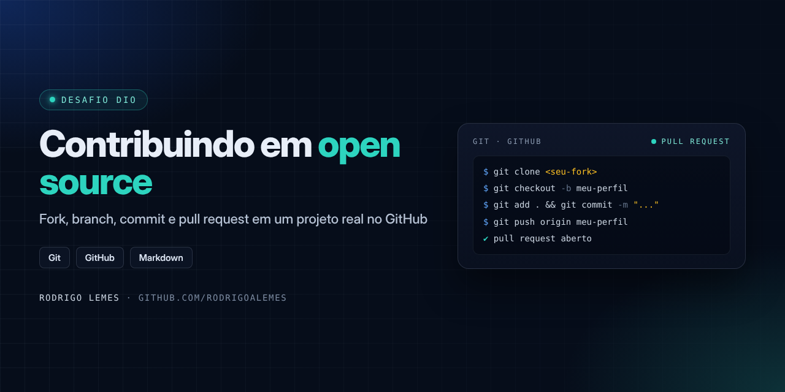
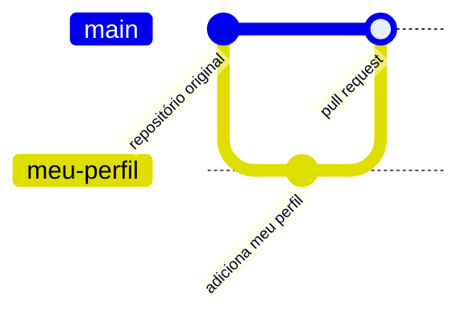

<p align="center">

</p>

<h1 align="center">Contribuindo em um Projeto Open Source</h1>
<p align="center"><i>Desafio de projeto da DIO — Digital Innovation One</i></p>

<p align="center">


</p>

## Sumário

- [Sobre o desafio](#sobre-o-desafio)
- [Fluxo de contribuição](#fluxo-de-contribuição)
- [Comandos utilizados](#comandos-utilizados)
- [Aprendizados](#aprendizados)
- [Autor](#autor)

## Sobre o desafio

Desafio da **DIO** para praticar o fluxo de contribuição em projetos open source no GitHub: copiar o repositório original (*fork*), trabalhar em uma *branch* própria e propor a alteração ao projeto por meio de um **pull request**.

## Fluxo de contribuição



## Comandos utilizados

```bash
# 1. Clonar o fork para a máquina
git clone https://github.com/<seu-usuario>/dio-lab-open-source.git
cd dio-lab-open-source

# 2. Criar uma branch para a contribuição
git checkout -b meu-perfil

# 3. Registrar a alteração
git add .
git commit -m "Adiciona meu perfil"

# 4. Enviar a branch para o GitHub
git push origin meu-perfil

# 5. Abrir o pull request no GitHub
```

| Comando | Para que serve |
| --- | --- |
| `git clone` | Copia o repositório para a máquina local |
| `git checkout -b` | Cria e muda para uma nova branch |
| `git add` / `git commit` | Prepara e registra as alterações |
| `git push` | Envia a branch para o repositório remoto |

## Aprendizados

- Diferença entre **fork**, **clone** e **branch**
- Como manter a contribuição isolada em uma branch própria
- Como abrir e descrever um **pull request**
- Escrita de documentação em **Markdown**

## Autor

**Rodrigo Lemes** · Analista de TI · Microsoft 365, AD/Entra ID, Automação, Power BI e IA aplicada

[](https://www.linkedin.com/in/rodrigoalemes/)
[](https://github.com/rodrigoalemes)
